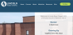
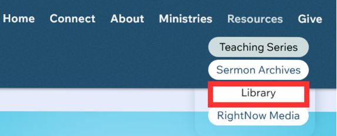
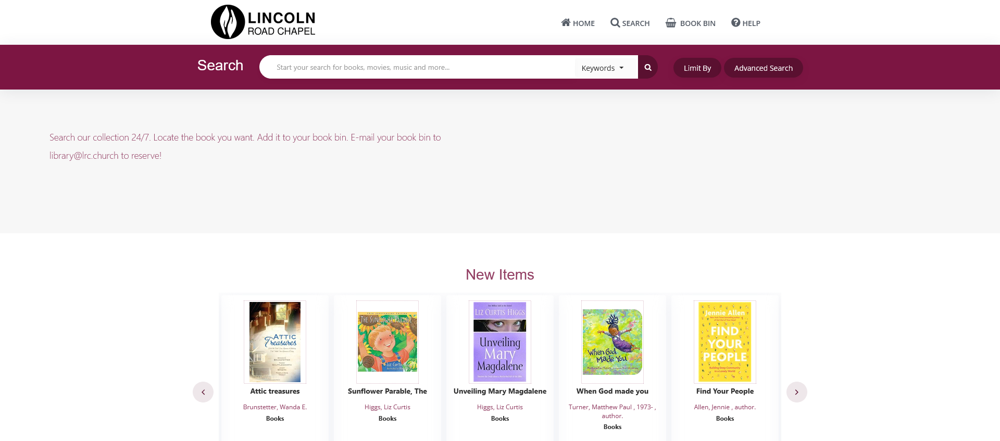

# Reserving a Library Book from the Church Website

Did you know that the library catalogue is available online? 

### 1.  Navigate to the church website. 
 
   

   
### 2.  Choose "Library" from the Resources menu. 
 

   
3.  The library catalogue appears:
 
 

   - The newest titles appear at the bottom of the screen

    

Search for and select a book. 

  
   You can search by Title, Author, or Keyword.
4.  Add your book to the book bin.
5.  Mail your selection to library@lrc.church 
