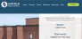
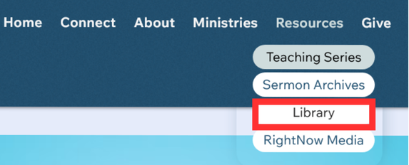
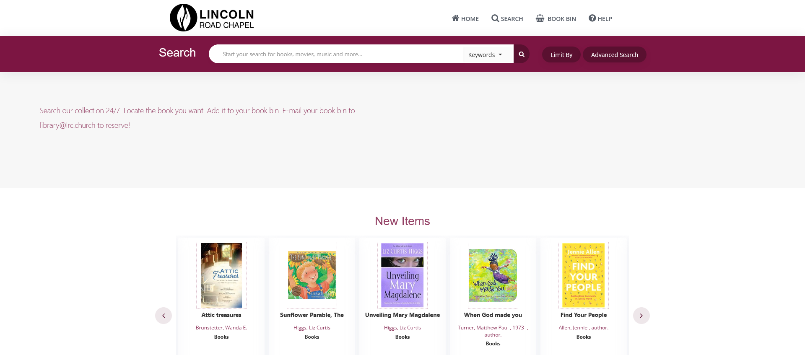
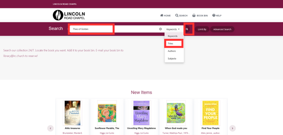
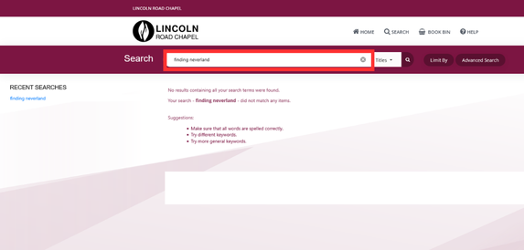
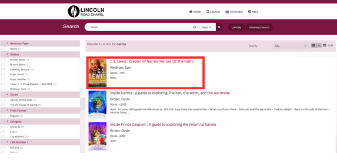
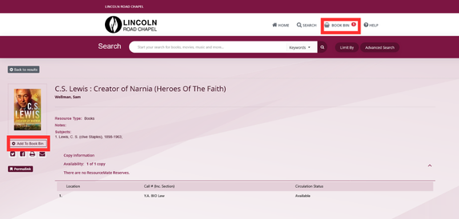
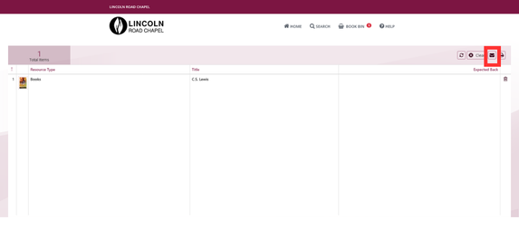
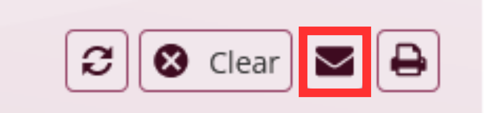
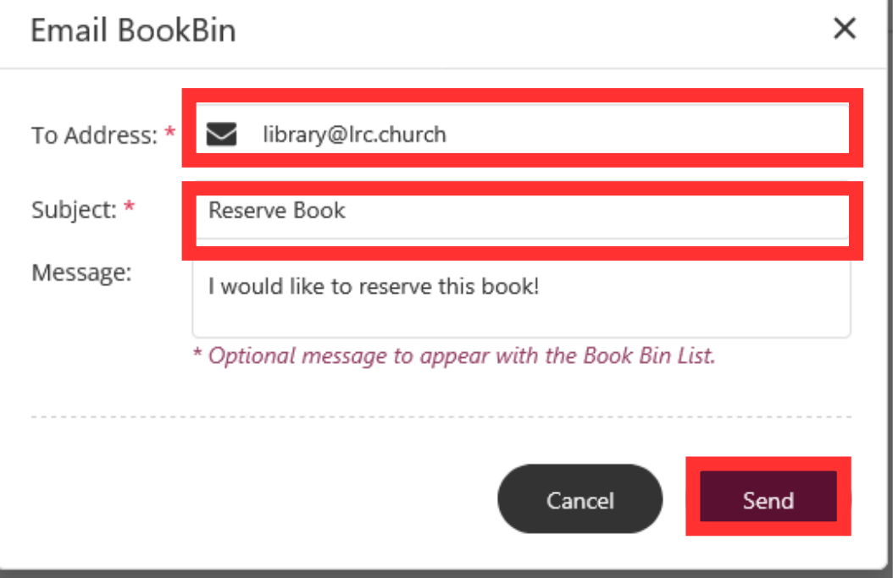

# Reserving a Library Book from the Church Website

_Did you know that the library catalogue is available for you to search online from the church website?_   
_Reserve a book online and it will be available for you to check out the following Sunday_.

### 1.  Navigate to the church website (www.lrc.church).
   

   

### 2.  Choose "Library" from the Resources menu.

   

### 3.  The library catalogue opens.

*   We have over 3000 books in our collection.
*   The newest titles appear at the bottom of the screen.

  
### 4.  Search for a book.

*   You can search by author, title, subject, or keyword by selecting the appropriate choice from the list.
*   A keyword search will look for the text anywhere in the record (including the title, subject, author name, or full text description).

*   Enter text in the search bar and press <kbd>Return</kbd> or click 🔍.
*   A list of books that match your query appears.
*   If the list is empty, click the X in the search bar and type your text again.
  

### 5.  Click a book on the list to select it.

   
### 6.  Click the "Add to Book Bin" button to place the book in your Book Bin.

*   The Book Bin icon at the top of the screen indicates the number of books in your bin.
*   You can add a maximum of 10 books to your bin.

### 7.  Once you have finished adding books to the bin, click the Book Bin to open it.

 
### 8. Click the envelope icon to email your book bin.
 

### 9.  Email your selection to library@lrc.church

*   The library volunteer will get your book ready on the following Sunday.
*   Come to the library after the service to pick up your book.
*   Enjoy your book for 3 weeks!   
